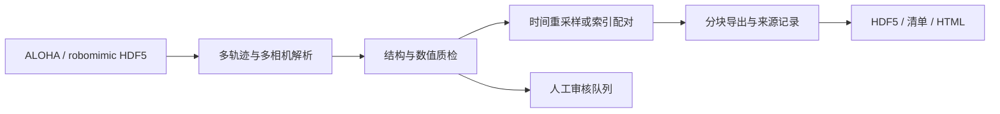

# TrajGuard：机器人多模态轨迹数据处理管线


> 面向具身智能与 VLA 训练的数据准备工程，覆盖轨迹解析、运动规则过滤、多模态重采样、语义重标注流程、视频可视化、并行处理和可追溯导出。

## 工程全貌

仓库包含完整流程演示和真实数据处理两个入口：`main_pipeline.py` 串联解析、过滤、重采样、模拟重标注与落盘；`python -m trajguard` 提供多轨迹、多相机处理、质量管理和断点恢复。它们使用不同输出格式，按任务选择入口。

| 功能 | 对应模块 | 工程中的实现 |
|---|---|---|
| HDF5 解析 | bridge_parser.py、trajguard/adapters.py | 提取图像、状态、动作、指令；TrajGuard 遍历多 episode 和相机 |
| 运动规则过滤 | kinematic_filter.py、trajguard/quality.py | 演示首尾位移与相邻帧差检查；真实处理支持累计运动量、数值有效性及有时间依据的速度检查 |
| 多模态重采样 | time_sync.py、time_sync_show.py、trajguard/alignment.py | 演示连续量线性插值、末列夹爪最近邻插值；TrajGuard 显式管理时间来源、边界及离散动作前值保持 |
| 语义重标注 | vlm_relabel.py、trajguard/labels.py | 首尾关键帧、描述 prompt、模拟文本输出；离线候选标签与审核状态校验 |
| 视频与成品检查 | bridge_parser.py、inspect_clean_data.py | RGB 像素序列导出 MP4；检查演示成品的形状与指令 |
| 并行调度 | main_pipeline.py、trajguard/pipeline.py | 文件级进程池；TrajGuard 增加可配并发、故障隔离、签名恢复与原子写入 |
| 数据构造与验证 | generate_test_cases.py、scripts/、tests/ | 合成异常样例、回归测试、真实数据性能测量与逐块一致性核验 |
| 质量管理 | trajguard/report.py、trajguard/storage.py | HTML 质量页、审核队列、来源索引、输入与成品哈希 |

重标注演示当前从预设文本随机返回结果，真实 API 分支尚未实现；这些文本用于展示流程。下面的真实 ALOHA 成果来自 TrajGuard 入口，未执行模型重标注。

## 处理成果

真实 ALOHA `episode_0` 和 `episode_1` 已跑通：**4000 个时间步、14 维状态/动作、三路相机共 12000 帧图像**。

| 处理前 | 处理后 |
|---|---|
| 两个 HDF5 文件，共 283.96 MB | 两个标准化成品，共 189.73 MB |
| 三路 JPEG 编码图像 | 保留全部编码字节，逐块核验一致 |
| 原始状态、动作字段 | 统一为 state、actions，数值核验一致 |
| 无记录时间戳 | 显式记录 index_only 和来源帧索引 |
| 原始文件 | 质量清单、来源 SHA256、成品哈希和 HTML 质量页 |

两条轨迹均通过当前基础质检。输出包括状态、动作、相机及来源信息；base_action、qvel、effort 等保留在源文件中，因此体积变化不代表全量数据无损压缩率。

实现过程见 [项目博客](docs/BLOG.md)，测量记录见 [benchmark.json](docs/assets/aloha-benchmark.json)。

## 项目背景

机器人示范数据同时包含视觉、状态和动作。处理时既要识别短轨迹、无效数值和异常运动，也要控制图像读写内存，并能追溯成品来源及处理配置。TrajGuard 将这些步骤组织成可配置、可恢复的离线管线，无需 GPU 或 API Key。

## 真实数据处理架构



- **数据解析**：支持 ALOHA 根目录及 robomimic data/demo_*，遍历多轨迹、多相机。
- **规则质检**：检查长度、NaN/Inf、累计运动量；时间与单位明确时支持速度阈值。
- **时间处理**：共同时间范围内重采样，连续量线性插值、离散动作前值保持；无时间信息时采用索引配对。
- **分块存储**：保留 JPEG 编码，按小批次复制图像并记录来源索引。
- **批处理与恢复**：多进程隔离、原子写入、输入与配置签名、成品哈希校验。
- **结果查看**：HTML 质量页、JSON 清单、人工审核队列和离线标签审核接口。

## 性能实测

环境：Windows、Ryzen 7 5800H、约 16 GB 内存、Python 3.12.4。上述真实数据交替使用 1/2 个工作进程，各运行 3 次，未清空文件缓存。

| 工作进程 | 管线耗时中位数 | 含启动及报告的总耗时中位数 | 单工作进程峰值 RSS |
|---|---:|---:|---:|
| 1 | 1.452 s | **2.020 s** | **55.02 MiB** |
| 2 | 1.405 s | 1.944 s | 53.70 MiB |

双进程的进程树采样峰值为 146.37 MiB，本次小任务并行收益有限，推荐单进程。耗时不含下载和独立一致性核验，两文件测试不代表大规模吞吐能力。恢复验证得到 resumed=2、processed=0。

## 快速运行

在仓库根目录安装：

```bash
python -m pip install -e ".[test,benchmark]"
```

从[公开数据目录](https://drive.google.com/drive/folders/1vhKa4tNPfMkeK7SW86vKorb39epTYW39)下载 episode_0.hdf5 和 episode_1.hdf5，放在仓库同级 data/aloha-blog/ 中：

```bash
python -m trajguard run --input ../data/aloha-blog --output ../outputs/aloha-real/processed --config configs/aloha_blog.json --workers 1
# 校验并复用成品
python -m trajguard run --input ../data/aloha-blog --output ../outputs/aloha-real/processed --config configs/aloha_blog.json --workers 1 --resume
```

打开 ../outputs/aloha-real/processed/report.html 查看结果。Windows PowerShell 可用 `& 'D:\anaconda\python.exe'` 替换 python。

没有真实数据时，可运行受控演示：

```bash
python scripts/make_demo.py --output ../work/trajguard-demo
python -m trajguard run --input ../work/trajguard-demo --output ../outputs/trajguard-demo --config configs/synthetic.json
```

## 运行完整流程演示

补充安装演示脚本所需依赖，在仓库根目录执行：

```bash
python -m pip install scipy opencv-python Pillow tqdm
python generate_test_cases.py
python time_sync_show.py
python main_pipeline.py
python inspect_clean_data.py
```

`generate_test_cases.py` 会写入 test_data 下的演示样例；`main_pipeline.py` 固定读取 test_data、写入 clean_data，不提供 --input/--output 参数。输出包含 images、qpos、actions、instruction，重标注为模拟模式。原有解析器读取约定字段的已解码像素，真实 ALOHA 压缩帧请使用前面的 TrajGuard 命令。

视频演示可对生成的 RGB 样例调用导出接口：

```bash
python -c "from bridge_parser import VLADatasetParser; p=VLADatasetParser('test_data/case1_perfect.hdf5'); p.extract_trajectory(); p.export_to_mp4('trajectory_preview.mp4')"
```

视频默认 30 fps，仅为预览播放设置。成品检查脚本对应演示输出结构；TrajGuard 成品使用 manifest.json 和 report.html 查看。

## 项目结构

```text
VLA-Data-Pipeline/
├── main_pipeline.py       # 完整流程演示与多进程调度
├── bridge_parser.py       # 字段解析与 MP4 导出
├── kinematic_filter.py    # 运动规则过滤演示
├── time_sync.py           # 连续/离散量插值演示
├── time_sync_show.py      # 50/30 个采样点重采样示例
├── vlm_relabel.py          # 首尾帧与模拟语义重标注
├── inspect_clean_data.py  # 演示成品结构检查
├── generate_test_cases.py # 合成正常及异常轨迹
├── trajguard/             # 真实数据处理、审核与恢复
├── configs/               # 默认、演示及真实 ALOHA 配置
├── scripts/               # 演示数据生成与性能实测
├── tests/                 # 回归测试
├── docs/
│   ├── BLOG.md            # 项目博客
│   ├── DATA_CONTRACT.md   # 字段、单位及时间语义
│   └── assets/            # 小体积实测记录
└── reproduction/          # 基线复现辅助工具
```

输出包含 episodes/*.hdf5、manifest.json、review_queue.json 和 report.html。可用成品以当前清单中 accepted 的路径为准。输入与输出目录需分离；更改配置后可能保留旧签名成品。

## 验证与扩展

```bash
python -m pytest
python scripts/benchmark_real.py --input ../data/aloha-blog --output ../outputs/aloha-real --config configs/aloha_blog.json --repeats 3 --workers 1 2
```

本次真实样本验证索引配对和数据保真；两条正常轨迹通过不代表异常检测准确率。当前提供离线标签审核接口，尚未接入真实 VLM 推理或开展策略训练。自定义接入见 [数据约定](docs/DATA_CONTRACT.md)。

## 致谢

项目参考 [Escapist-coder/VLA-Data-Pipeline](https://github.com/Escapist-coder/VLA-Data-Pipeline)，保留其原始脚本；TrajGuard 实现位于 trajguard/。原介绍见 [上游 README](docs/UPSTREAM_README.md)。