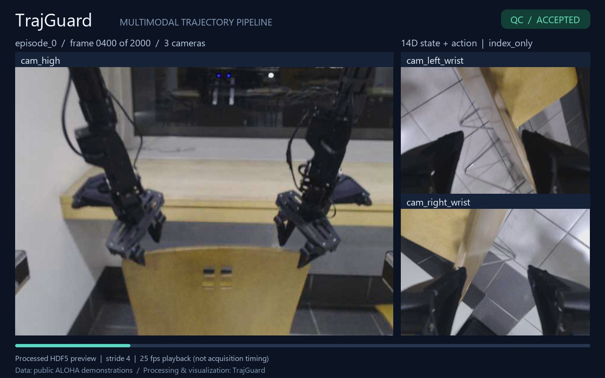
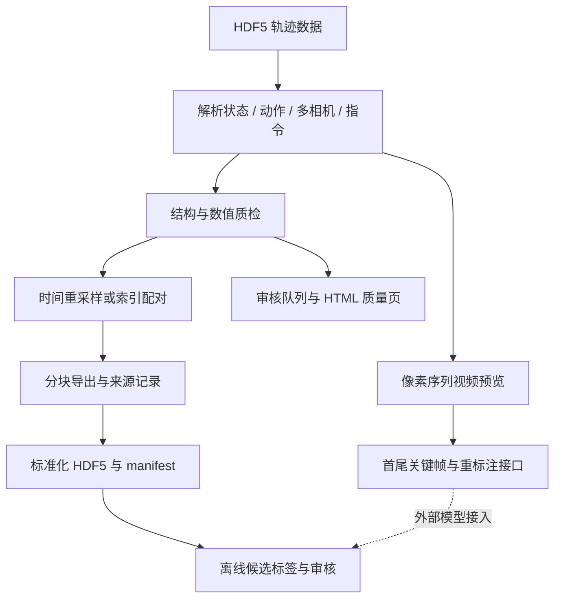

# TrajGuard · 机器人多模态轨迹数据处理与质量管理


> 面向具身智能与 VLA 数据准备，覆盖轨迹解析、运动规则过滤、多模态重采样、语义标注审核、视频可视化和可追溯批处理。

## 🎥 效果演示（Demo）

[](assets/trajguard-demo.mp4)

**[▶ 播放 / 下载演示视频](assets/trajguard-demo.mp4)**

*从 TrajGuard 导出的 HDF5 成品生成：主视角 + 左右腕部相机，展示轨迹帧索引与质检状态。源数据为公开 ALOHA 示范，处理及视频制作由本项目完成。*

视频长 40 秒，采用间隔取帧和 25 fps 预览播放；画面中的 index_only 表示索引配对。播放速度不代表采集时间，视频未叠加模拟语言标签。

| 原始数据 | 管线输出 |
|---|---|
| 状态、动作和多路相机分散存储 | 标准化 HDF5，保留相机与来源索引 |
| 质量信息需要逐条检查 | 规则判定、HTML 质量页与人工审核队列 |
| 处理来源难以复查 | 输入/配置签名、来源和成品哈希 |
| 重复运行整批任务 | 校验后复用已完成结果 |

## 📌 项目背景（Background）

机器人示范数据包含视觉、状态、动作和语言指令。TrajGuard 将数据接入、质量检查、时间处理、标准化导出与结果审核组织为完整工作流，使每条输出轨迹都能追溯到来源文件、处理配置和源帧索引。

核心管线离线运行，无需 GPU 或 API Key。工程同时提供模块化流程演示、命令行批处理工具、数据生成与验证脚本。

**阅读入口：** [实现详解](docs/BLOG.md) · [数据约定](docs/DATA_CONTRACT.md)

## ⚙️ 系统架构（System Architecture）



推荐使用 `python -m trajguard` 进行批处理。根目录的 `main_pipeline.py` 串联解析、过滤、重采样、模拟重标注和落盘，适合演示完整模块协作。两种入口的输出 schema 不同。

| 功能 | 实现 |
|---|---|
| 多模态解析 | 接入 ALOHA、robomimic 风格 HDF5，读取状态、动作、指令和多路相机 |
| 轨迹质量检查 | 长度、NaN/Inf、累计运动量、时间有效性，以及时间和单位明确时的速度检查 |
| 多模态重采样 | 共同时间范围内处理连续量与离散动作，记录时间来源和插值策略 |
| 图像存储 | JPEG 编码帧分块复制，支持原始像素及变长编码帧，保留相机来源索引 |
| 语义标注 | 首尾关键帧与 prompt 示例、候选标签生成接口、标签来源和审核状态校验 |
| 视频可视化 | RGB 像素序列导出 MP4，检查成品字段、形状和指令 |
| 并行处理 | 文件/轨迹级任务调度，可配置工作进程数，单轨迹失败隔离 |
| 断点恢复 | 输入与配置签名、成品 SHA256 校验、原子写入和任务清单 |
| 质量管理 | accepted/review/rejected/failed 状态、HTML 质量页和人工审核队列 |

语义重标注模块提供首尾帧与模拟输出演示；真实 VLM 客户端是待接入扩展点。离线标签审核可直接使用，原始指令独立保留。

## 📊 处理成果（Results）

| 原始数据 | 处理结果 |
|---|---|
| 不同 HDF5 字段布局 | 统一的 state、actions、images 与 instruction |
| 多相机编码图像 | 按相机保留编码字节及来源索引 |
| 时间信息可能缺失 | 显式区分记录时间、假定频率和索引配对 |
| 轨迹质量需要逐条检查 | 规则结果、状态分类和可筛选质量页 |
| 处理过程难以复查 | 来源哈希、配置、版本、签名和成品哈希 |
| 重复执行整批任务 | 校验已有成品后复用有效结果 |

已生成的 ALOHA 成品保留 cam_high、cam_left_wrist、cam_right_wrist 三路相机及 14 维状态/动作；导出图像编码字节、状态和动作数值通过一致性核验，恢复运行能够复用已完成任务。原始测量记录保存在 [实验记录](docs/assets/aloha-benchmark.json)。

```text
output/
├── episodes/<任务签名>.hdf5
├── manifest.json          # 当前成员、规则结果、签名与成品路径
├── review_queue.json      # 待人工检查的任务
└── report.html            # 可筛选质量页
```

成品导出支持的状态、动作和相机字段；其他源字段继续保留在原文件。下游从当前 manifest 的 accepted 列表读取成品。

## 🚀 快速复现（Quick Start）

### 1. 安装

Python 3.10+，在仓库根目录执行：

```bash
python -m pip install -e ".[test,benchmark]"
```

### 2. 运行示例

```bash
python scripts/make_demo.py --output ../work/trajguard-demo
python -m trajguard run --input ../work/trajguard-demo --output ../outputs/trajguard-demo --config configs/synthetic.json --workers 1
```

打开 `../outputs/trajguard-demo/report.html` 查看结果。

### 3. 处理自己的数据

将 HDF5 文件放入仓库同级 `data/episodes/`，按数据语义调整配置：

```bash
python -m trajguard run --input ../data/episodes --output ../outputs/processed --config configs/default.json --workers 1
python -m trajguard run --input ../data/episodes --output ../outputs/processed --config configs/default.json --workers 1 --resume
```

输入和输出目录需分离。工作进程数通过 `--workers` 调整。ALOHA 示例配置为 `configs/aloha_blog.json`；时间戳路径、单位和动作列设置见 [数据约定](docs/DATA_CONTRACT.md)。

### 4. 候选标签与审核

```bash
python -m trajguard label-template --manifest ../outputs/processed/manifest.json --output ../outputs/processed/candidates.json
# 填写候选指令、来源和审核信息后执行
python -m trajguard labels --manifest ../outputs/processed/manifest.json --input ../outputs/processed/candidates.json --output ../outputs/processed/labels.json
```

标签状态包括 candidate、reviewed、uncertain。reviewed 需要审核人，VLM 来源需要 model 和 prompt_version；校验来源及结构，语义正确性由审核环节判断。

## 🎬 生成自己的演示视频

```bash
python -m pip install Pillow imageio-ffmpeg
python scripts/render_demo.py --manifest ../outputs/aloha-real/processed/manifest.json --output assets/trajguard-demo.mp4 --swap-rb
```

脚本从 accepted 成品逐帧读取三路相机编码数据，生成 H.264 MP4、封面和预览元数据。`--swap-rb` 是当前 ALOHA 样本经参考画面核对后的颜色设置；其他数据需根据颜色语义选择。默认字体为 Windows Segoe UI，Linux 使用 `--font` 指定可用的 TrueType 字体路径。

## 🧩 模块演示（Modules）

```bash
python -m pip install scipy opencv-python Pillow tqdm
python generate_test_cases.py
python time_sync_show.py
python main_pipeline.py
python inspect_clean_data.py
```

生成器写入 `test_data/`，主脚本固定读取该目录并输出 `clean_data/`，指令为模拟文本。其解析器接收约定字段的已解码图像；压缩 ALOHA 数据使用 TrajGuard 入口。

```bash
python -c "from bridge_parser import VLADatasetParser; p=VLADatasetParser('test_data/case1_perfect.hdf5'); p.extract_trajectory(); p.export_to_mp4('trajectory_preview.mp4')"
```

视频接口接受 RGB 像素，默认以 30 fps 播放；播放速率与采集时间语义分开管理。

## 📂 项目结构（Structure）

```text
.
├── main_pipeline.py       # 模块串联与进程池演示
├── bridge_parser.py       # 字段解析、MP4 导出
├── kinematic_filter.py    # 长度、位移、帧间变化检查
├── time_sync.py           # 线性与最近邻插值
├── time_sync_show.py      # 重采样示例
├── vlm_relabel.py          # 关键帧、prompt、模拟重标注
├── inspect_clean_data.py  # 演示成品检查
├── generate_test_cases.py # 合成正常/异常轨迹
├── trajguard/             # 命令行、解析、质检、对齐、存储、审核
├── configs/               # 处理配置
├── scripts/               # 数据生成、评估、性能测量
├── tests/                 # 回归测试
├── docs/                  # 实现文章、数据约定与实验记录
└── reproduction/          # 基线复现辅助工具
```

## 🧪 测试与性能（Validation）

```bash
python -m pytest
```

测试覆盖时间边界、离散动作、异常数值、多轨迹解析、编码帧保真、损坏成品恢复及标签来源校验。真实 ALOHA 数据测量入口：

```bash
python scripts/benchmark_real.py --input ../data/aloha-blog --output ../outputs/aloha-real --config configs/aloha_blog.json --repeats 3 --workers 1 2
```

该脚本针对 ALOHA 索引配对导出进行测量与核验。分块读写控制图像缓冲量；有界任务提交控制并发积压；断点恢复避免重复导出。并发配置应根据磁盘带宽、轨迹长度和内存预算选择。

## 致谢

项目参考 [Escapist-coder/VLA-Data-Pipeline](https://github.com/Escapist-coder/VLA-Data-Pipeline)，原始脚本及 [上游说明](docs/UPSTREAM_README.md) 保留在仓库中。ALOHA 数据入口见 [公开数据目录](https://drive.google.com/drive/folders/1vhKa4tNPfMkeK7SW86vKorb39epTYW39)。

## 🔌 LeRobot 与 DROID 扩展

核心数据处理保持与模型和机器人控制软件解耦；LeRobot 是可选导出集成，π₀.₅ 和 Franka 是下游应用案例。

- **LeRobot 0.6.1 导出：** 将当前 accepted 成品映射为状态、动作、多相机和任务，支持图像与 H.264 视频存储，保留源轨迹和帧映射。
- **DROID RLDS 接入：** 读取官方 TFDS 发行数据中的关节位置、夹爪、三路相机及语言指令；原始 H5 + 外部 MP4 形式尚未支持。
- **训练数据管理：** 固定间隔校验与连续片段切分，按源轨迹身份划分训练/验证集，单独计算训练帧统计量，检查未来动作块与边界 padding。
- **语义与诊断：** 配置状态/动作定义、单位、坐标系、旋转表示及逐相机颜色；未知信息保留诊断，需要相关语义的步骤会检查必要条件。

Python 3.12+ 独立环境可运行最小格式转换：

```bash
python -m pip install -e ".[test,lerobot]"
python -m trajguard export-lerobot --manifest ../outputs/trajguard-demo/manifest.json --config configs/lerobot_fixture.json --output ../outputs/trajguard-demo-lerobot
python scripts/check_lerobot.py --root ../outputs/trajguard-demo-lerobot --horizon 50
```

先运行上文“运行示例”生成输入；该导出配置仅用于合成样例。基础质检流程不需要 LeRobot。DROID 的 TFDS 可选依赖及真实数据命令见 [集成说明](docs/LEROBOT.md)。

## ✅ 真实公开数据验证

| 数据 | 规模 | 实际验证 |
|---|---|---|
| ALOHA episode_0 / episode_1 | 4000 个时间步、14 维状态/动作、三路相机共 12000 帧 | TrajGuard → LeRobot H.264 → 实际读取，视频全帧解码通过 |
| DROID 官方 RLDS（Franka） | 404 个时间步、8 维状态/动作、三路相机共 1212 帧 | TFDS → TrajGuard → LeRobot 图像模式，原始与转换数据逐步核对通过 |

两组均通过数值、任务关联、图像对应、50 步未来动作及末尾 padding 检查，完整成品恢复验证通过。独立集成环境 **70 项测试通过**。频率采用显式假设；ALOHA 缺失指令使用标记为人工粗描述的文本，不作为原始精细标注。模型训练和真机评测仍待验证。

[完整验证结果与复现命令](docs/REAL_PUBLIC_VALIDATION.md) · [兼容性表](docs/COMPATIBILITY.md) · [扩展指南](docs/EXTENDING.md) · [贡献方式](CONTRIBUTING.md)

## 许可与数据说明

保留已有上游来源说明。当前完整项目许可证和部分样例再分发条件仍待确认，具体文件归属及发布待办见 [许可与数据状态](docs/RELEASE_STATUS.md)。
