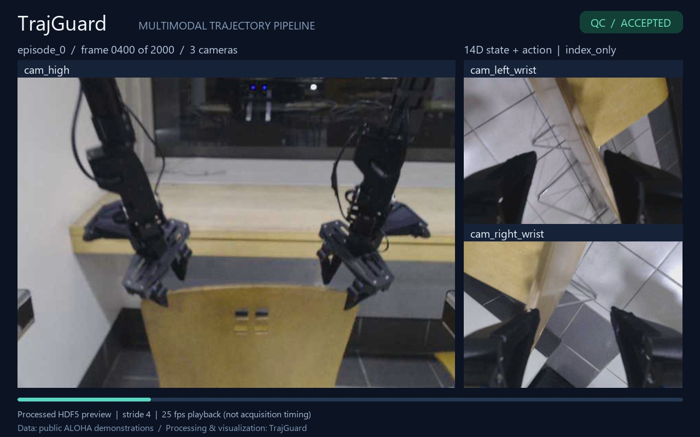

# 具身智能数据工程实战：用 Python 构建机器人多模态轨迹处理管线

> 项目名称：TrajGuard
>
> 技术栈：Python、NumPy、h5py、SciPy、OpenCV、Pillow、concurrent.futures、pytest。
>
> 本文介绍从 HDF5 数据解析、运动规则过滤、多模态重采样，到语义标注审核、视频预览与可追溯批处理的完整工程实现。

## 视频效果演示

[](../assets/trajguard-demo.mp4)

[观看本项目生成的演示视频](../assets/trajguard-demo.mp4)

视频直接读取 TrajGuard 导出的 HDF5 成品，展示主视角、左右腕部相机、轨迹帧索引和质量状态。源数据为公开 ALOHA 示范，数据处理与视频制作由本项目完成。视频使用间隔取帧、25 fps 预览播放，不表示采集时间，也未加入模拟语言标签。

复现视频：

```bash
python -m pip install Pillow imageio-ffmpeg
python scripts/render_demo.py --manifest ../outputs/aloha-real/processed/manifest.json --output assets/trajguard-demo.mp4 --swap-rb
```

`--swap-rb` 是这批数据核对后的颜色设置。发布到 CSDN 时，将生成的 assets/trajguard-demo.mp4 上传为视频，并以 assets/trajguard-demo.jpg 作为封面。
## 1. 为什么要做机器人数据处理管线

机器人示范数据往往由相机图像、关节或末端状态、动作指令以及任务描述共同组成。文件能够读取，并不意味着它已经适合后续训练：短轨迹可能来自误触录制，无效数值可能导致训练异常，缺少时间信息的状态与图像也需要明确配对规则。

工程还需要解决另一类问题：处理过程如何控制内存，单条轨迹失败是否会中断整个任务，重复运行能否复用已有结果，某个输出究竟来自哪份原始文件。

TrajGuard 将这些需求组织成统一流程。核心数据处理离线运行，不依赖 GPU；图像、状态、动作和语言分别保留语义与来源，在标准化导出后通过质量页和审核队列管理结果。

## 2. 整体架构

```text
                     HDF5 轨迹数据
                           │
               状态 / 动作 / 相机 / 指令解析
                           │
                    结构与数值质检
                           │
                 时间重采样或索引配对
                           │
                  分块导出与来源记录
                           │
              标准化 HDF5 + manifest 清单
                  │                  │
           HTML 与审核队列      候选标签与审核

辅助流程：图像像素 → 视频预览 → 首尾关键帧 → 重标注接口
```

工程提供两个入口。`main_pipeline.py` 用模块化脚本展示解析、过滤、插值、模拟重标注和落盘的串联过程；`python -m trajguard` 负责多轨迹、多相机批处理、质量管理和断点恢复。两者的输出格式各有对应的查看方式。

## 3. HDF5 解析：统一组织多模态数据

ALOHA 风格数据通常将状态放在 `observations/qpos`，动作放在 `action`，相机图像放在 `observations/images/`。robomimic 风格则常将多个示范放在 `data/demo_*` 下。

```text
ALOHA episode.hdf5
├── action
└── observations/
    ├── qpos
    └── images/
        ├── cam_high
        ├── cam_left_wrist
        └── cam_right_wrist
```

解析层将不同字段映射为内部的状态、动作、相机、指令及时间信息，同时保留状态类型。例如，关节位置和末端位置可以都是向量，但它们的单位与物理含义不同，检查阈值需要分别配置。

根目录的 `bridge_parser.py` 提供约定字段的读取及 MP4 导出；`trajguard/adapters.py` 遍历多条 episode 和多路相机。图像数据集保持可分块访问，避免解析阶段就把整段视频加载成像素数组。

## 4. 运动规则过滤：让质量判断可解释

### 4.1 长度与数值有效性

首先检查轨迹是否为空、长度是否满足要求，以及状态与动作是否含有 NaN 或 Inf。检查失败时记录规则及原因，使后续可以定位问题。

### 4.2 用累计运动量描述轨迹活动程度

首尾状态差能够衡量净位移，但机器人运动后回到起点时，净位移仍可能很小。因此，质检使用相邻状态变化的累计量：

```text
path_length = Σ ||q[t] - q[t-1]||₂
```

累计量低于配置阈值时，轨迹可以进入人工复核。静止是否意味着无效，仍与任务有关，例如等待或保持姿态可能是合理行为。

### 4.3 速度检查需要时间和单位

有时间信息时，速度依据状态差与时间差计算：

```text
v[t] = (q[t] - q[t-1]) / (time[t] - time[t-1])
```

阈值需要明确状态单位和参与检查的列，避免将不同量纲直接混合。`kinematic_filter.py` 的模块示例展示了长度、首尾位移和帧间变化检查；其中帧间差没有除以时间，属于变化量指标。

## 5. 多模态重采样：连续量与离散量分开处理

### 5.1 三种时间模式

| 模式 | 使用条件 | 含义 |
|---|---|---|
| recorded_timestamps | 各流具有记录时间戳 | 按记录时间处理，要求处于同一时钟域 |
| assumed_rate | 用户显式提供所需采样率 | 构造时间轴并记录频率假设 |
| index_only | 各流无时间信息且长度一致 | 仅按索引对应 |

部分流有时间而其他流缺失时，需要补充必要配置。索引配对结果会明确记录模式，供下游判断使用条件。

### 5.2 插值策略

连续状态可以在线性插值适用的语义下进行重采样。动作默认采用前值保持，也可以配置连续动作线性插值，并显式指定离散动作列。离散状态通过前值保持避免引入未观测到的中间值。

`time_sync.py` 展示连续量线性插值与末列夹爪最近邻插值，`time_sync_show.py` 展示不同采样点数量之间的转换。TrajGuard 的时间模块在共同覆盖区间内处理，并限制大时间缺口及相机匹配偏差。

## 6. 图像处理：分块保留编码，按需解码预览

JPEG 编码帧和已解码图像属于不同存储形态。前者通常是一段字节，后者是 H×W×C 像素数组。基础轨迹质检和数据整理可以直接复制编码载荷，减少整段图像展开带来的内存与磁盘开销。

存储模块按 `chunk_frames` 分批读取，固定形状图像使用 HDF5 分块存储与 LZF 压缩，同时记录每个输出帧对应的源索引。变长编码数组通过逐帧复制保留其存储类型。

视频预览使用另一条路径：`VLADatasetParser.export_to_mp4` 接收 RGB 像素序列，转换为 OpenCV 的 BGR 后写入 MP4。JPEG 数据在进入像素接口前需要解码，并确认颜色语义。视频播放帧率仅控制预览速度。

## 7. 语义重标注与人工审核

语言指令连接视觉变化与任务语义。工程提供首尾关键帧提取、PIL 图像转换以及任务描述 prompt，要求描述操作对象、属性和空间关系变化。

`vlm_relabel.py` 当前使用预设文本展示重标注流程，真实 VLM 客户端保留为扩展点。它体现了关键帧与文本输出之间的接口组织；接入模型后仍需验证描述是否符合实际轨迹。

离线审核模块将标签与轨迹签名关联，保存以下字段：

| 字段 | 用途 |
|---|---|
| job_id / signature | 绑定轨迹及对应处理版本 |
| candidate_instruction | 候选指令 |
| provider / model / prompt_version | 标注来源 |
| review_status / reviewer | 审核状态及审核人 |
| notes | 补充说明 |

审核状态分为 candidate、reviewed 和 uncertain。系统检查重复引用、失效签名和必填来源字段，保留原始指令；内容正确性由审核环节判断。

## 8. 并行处理与断点恢复

### 8.1 任务调度

多进程适合将独立轨迹分配给不同工作进程。TrajGuard 允许配置工作进程数，并限制在途任务数量，避免任务积压。单条轨迹失败会记录原因，其他任务仍可继续。

并发度需要结合存储带宽、轨迹长度和内存预算选择。图像读写集中时，增加工作进程未必能线性提高吞吐。

### 8.2 可验证的恢复

任务签名由输入内容、配置和工具版本等信息决定。恢复运行时，系统校验源文件及成品哈希，确认结果有效后复用；输入、配置变化或成品损坏会影响复用判断。

HDF5 先写临时文件，关闭后原子替换正式成品。每条轨迹完成后保存清单，输出锁防止多个任务同时写入同一输出目录。

## 9. 处理成果与输出结构

工程已生成 ALOHA 标准化成品，保留高位相机、左右腕部相机及 14 维状态和动作。独立核验逐块比较图像载荷、源索引及状态/动作数值，确认对应数据一致；恢复运行也验证了已完成任务的复用。

```text
output/
├── episodes/<任务签名>.hdf5
├── manifest.json
├── review_queue.json
└── report.html

成品.hdf5
├── state
├── actions
├── instruction
├── images/
│   ├── cam_high
│   ├── cam_left_wrist
│   └── cam_right_wrist
└── source_indices/
```

具备时间信息时，成品还记录相关时间数组。文件属性保存来源与处理模式。当前导出覆盖支持的状态、动作、相机和来源字段，其他采集字段保留在原文件中。

HTML 质量页用于筛选任务状态；manifest 保存规则、签名、哈希及成品路径；review_queue 提供人工检查入口。下游应读取当前清单中的 accepted 成品，避免直接扫描文件夹混入历史版本。

## 10. 安装与运行

### 10.1 安装依赖

Python 3.10+，在仓库根目录运行：

```bash
python -m pip install -e ".[test,benchmark]"
```

### 10.2 运行数据处理管线

```bash
python scripts/make_demo.py --output ../work/trajguard-demo
python -m trajguard run --input ../work/trajguard-demo --output ../outputs/trajguard-demo --config configs/synthetic.json --workers 1
```

打开 `../outputs/trajguard-demo/report.html` 查看结果。处理自己的 HDF5 数据时：

```bash
python -m trajguard run --input ../data/episodes --output ../outputs/processed --config configs/default.json --workers 1
python -m trajguard run --input ../data/episodes --output ../outputs/processed --config configs/default.json --workers 1 --resume
```

输入和输出目录分开设置。配置中的状态单位、时间路径、动作列和阈值应与数据语义对应。

### 10.3 生成与审核标签

```bash
python -m trajguard label-template --manifest ../outputs/processed/manifest.json --output ../outputs/processed/candidates.json
```

填写候选文本与审核信息后：

```bash
python -m trajguard labels --manifest ../outputs/processed/manifest.json --input ../outputs/processed/candidates.json --output ../outputs/processed/labels.json
```

### 10.4 运行模块化完整流程

```bash
python -m pip install scipy opencv-python Pillow tqdm
python generate_test_cases.py
python time_sync_show.py
python main_pipeline.py
python inspect_clean_data.py
```

生成器写入 test_data，主脚本固定从该目录读取并输出到 clean_data，标签为模拟文本。成品字段为 images、qpos、actions、instruction，与 TrajGuard schema 分别使用对应查看工具。

### 10.5 导出视频

```bash
python -c "from bridge_parser import VLADatasetParser; p=VLADatasetParser('test_data/case1_perfect.hdf5'); p.extract_trajectory(); p.export_to_mp4('trajectory_preview.mp4')"
```

该命令使用生成的 RGB 图像样例，默认 30 fps 导出预览。

## 11. 配置、测试与性能测量

| 配置项 | 作用 |
|---|---|
| min_frames | 最少轨迹帧数 |
| min_path_length | 最低累计运动量 |
| checked_state_indices | 参与运动检查的状态列 |
| max_speed / state_unit | 速度阈值及状态单位 |
| reference_camera | 参考相机 |
| discrete_action_indices | 离散动作列 |
| action_interpolation | 动作前值保持或线性插值 |
| max_gap_seconds | 时间插值间隔限制 |
| chunk_frames | 图像复制批次大小 |

回归验证：

```bash
python -m pytest
```

测试覆盖时间边界、异常数值、往返运动、离散动作、编码图像保真、多轨迹处理、成品损坏恢复与标签来源。ALOHA 索引配对导出的性能测量入口：

```bash
python scripts/benchmark_real.py --input ../data/aloha-blog --output ../outputs/aloha-real --config configs/aloha_blog.json --repeats 3 --workers 1 2
```

测量脚本记录管线耗时、含进程启动的总耗时、工作进程内存与进程树采样内存，并执行一致性核验及恢复验证。不同口径分开保存，便于复查。

## 12. 工程组织与扩展方向

```text
.
├── bridge_parser.py / kinematic_filter.py / time_sync.py
├── vlm_relabel.py / main_pipeline.py / inspect_clean_data.py
├── generate_test_cases.py / time_sync_show.py
├── trajguard/       # 核心处理与命令行
├── configs/         # 数据语义和规则配置
├── scripts/         # 数据生成与测量
├── tests/           # 回归验证
├── docs/            # 使用说明与数据约定
└── reproduction/    # 复现辅助工具
```

后续可以在现有流程中接入真实 VLM 服务、增加训练格式导出器，并通过人工标注数据评估异常检测质量。来源追踪与审核记录可以帮助定位问题，让数据准备、人工复核和训练使用共享同一份数据依据。

## 参考与致谢

项目参考 [Escapist-coder/VLA-Data-Pipeline](https://github.com/Escapist-coder/VLA-Data-Pipeline)，保留原始模块与来源说明。ALOHA 数据入口：[公开数据目录](https://drive.google.com/drive/folders/1vhKa4tNPfMkeK7SW86vKorb39epTYW39)。